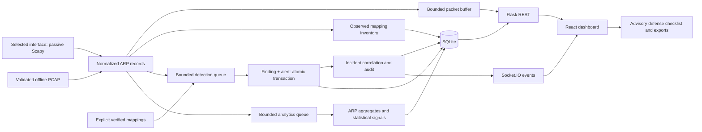

# NetGuard project overview

NetGuard is a local, passive ARP observation and investigation application. ARP does not authenticate IP–MAC claims; conflicting claims may indicate spoofing, but DHCP changes, equipment replacement and incomplete visibility can also explain them. NetGuard preserves evidence for human investigation instead of declaring an attack or modifying the network.

## Objectives and architecture

The application discovers mappings, compares observed claims, produces explainable suspicious findings, tracks alerts and investigations, and offers advisory response checklists. Live and imported evidence remain separate. Trust is an explicit administrator decision.

React 19, TypeScript, Vite, React Router, Lucide and Recharts provide the dashboard. Flask, Flask-SocketIO, Scapy, SQLAlchemy and SQLite provide the local backend. REST is authoritative; Socket.IO triggers timely updates and REST reconciliation after reconnect. The Vite proxy keeps both transports same-origin.

| Module | Responsibility |
|---|---|
| `backend/capture` | Explicit-interface receive socket, ARP normalization, bounded buffer, strict offline file validation |
| `backend/services/monitor.py` | Single-session start/stop/error lifecycle; Active only after successful capture startup |
| `backend/services/inventory.py` | Separate observed and trusted mappings, normalization, deduplication |
| `backend/detection` | Bounded asynchronous rule processing and packet evidence |
| `backend/services/alerts.py` | Persisted alert lifecycle and audits |
| `backend/incidents` | Correlation, investigation transitions, external-action reports, scoped exports |
| `backend/database` | Additive schema initialization, foreign keys, constraints, serialized transactions, storage ceiling |
| `backend/host_guard.py` | Loopback Host validation before REST and Socket.IO |
| `frontend/src/services`, `context`, `hooks` | Typed adapters, bounded events, reconnect reconciliation, local notification preferences |
| `backend/analytics` | Idempotent ARP observations, filtered aggregates, time buckets, frequency heuristic, JSON/CSV reports |
| `frontend/src/pages` | Overview, Monitor, Analytics, Devices, Threats, Incidents, Defense, Settings |

## Detection methodology

| Rule | Default evidence/window | Interpretation |
|---|---|---|
| Conflicting claims | Different MAC claims for one IP within 60 seconds | Medium severity/confidence; verified replacement and expired history avoid obvious false positives |
| Gateway impersonation | Mismatch against an explicitly configured, verified live gateway mapping | Baseline-backed concern; repeated evidence can raise severity to High; never infer a gateway |
| Reply burst | 30 replies within 10 seconds | Medium/Low confidence; gratuitous context reduces severity |
| Uncorrelated replies | 5 replies within 10 seconds after 5-second warmup, request correlation window 5 seconds | Low severity/confidence; missing requests are incomplete visibility, not proof; gratuitous replies excluded |

Default cooldown is 60 seconds. Findings retain rule, source, interface/session, timestamps, MAC comparisons, packet references, reason, confidence and investigation status. All remain `suspicious_observation`. Exact thresholds and severity logic are documented in PHASE5.md and implemented in `backend/detection/rules.py`.

## Phase 9 analytics

The analytics dashboard summarizes actual persisted ARP observations and distinguishes live capture from offline PCAP replay. It adds request/reply counts, address and mapping aggregates, time buckets, capture sessions, queue-drop indicators, frequency heuristics, and JSON/CSV summary exports. Statistical signals are not security-rule findings or confirmed attacks. See [PHASE9.md](PHASE9.md) for schemas, algorithms, API contracts, and limitations.

Phase 10 adds bounded metadata-only `.pcap`/`.pcapng` analysis, descriptive session comparisons, and an administrator-approved immutable ARP baseline with audit history. Uploaded packet payloads are not retained, and uploads/baselines do not enter live inventory or alert workflows. See [PHASE10.md](PHASE10.md) and [PHASE10_AUDIT.md](PHASE10_AUDIT.md) for the audit, API, validation limits, and remaining roadmap.

## Boundaries and future work

This is a single-process localhost academic application, not a production IDS or authenticated multi-user service. Reads and capture controls are local and unauthenticated; administrator mutations and evidence exports require a configured token. SQLite is not encrypted, and a filesystem owner can alter audits. Capture inventory writes remain synchronous; analysis can drop work under overload and reports degradation. Raw packet history is bounded and nonpersistent. Historical activity charts remain explicitly unavailable; saved UI detection settings are drafts, while server thresholds use environment configuration.

Future work may include authenticated readers/roles, a separately privileged receive-only capture helper, configurable retention and backups, network identities beyond interface names, stronger durable event delivery, chart aggregation, and broader browser/live-adapter validation. No automated defensive network actions are part of this delivery.

See [DEMO_GUIDE.md](DEMO_GUIDE.md) for installation and presentation, [TESTING_REPORT.md](TESTING_REPORT.md) for evidence and manual checks, and [PHASE8.md](PHASE8.md) for the final changes.
