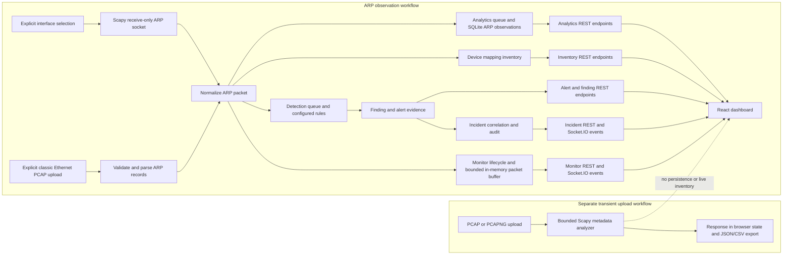
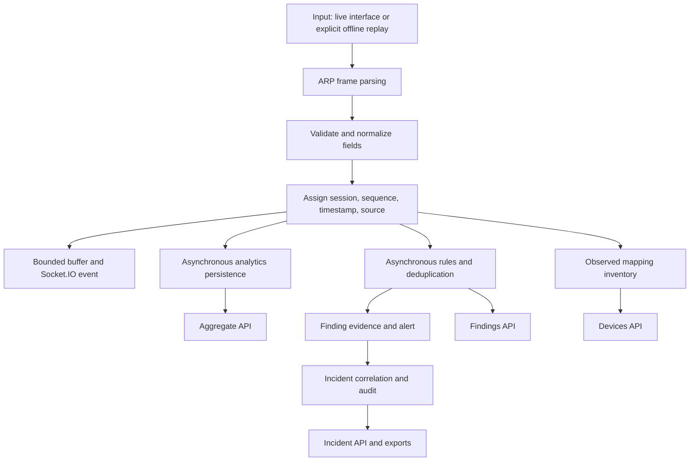

# NetGuard AI — Project Summary and Technical Walkthrough

> **Implementation-based description.** This document describes the code currently in this repository. “Finding” and “anomaly” mean evidence worth review; neither is a confirmed attack verdict. Live capture, persisted protocol analytics, ARP rule detections, and uploaded-PCAP metadata analysis are separate paths and are identified as such below.

## 1. Project overview

NetGuard is a local web application for passive ARP/TCP/UDP/DNS observation and analytics, ARP device-mapping history, explainable suspicious-activity findings, and incident investigation. An operator can select protocols for receive-only capture on one local interface or import a classic Ethernet PCAP for isolated replay. The application also offers a separate bounded PCAP/PCAPNG metadata-analysis upload. It does not transmit packets, block devices, change network configuration, or prove that suspicious observations are attacks.

The practical problem is that IP-to-MAC claims on a local network are unauthenticated. A changed or conflicting claim can be useful evidence, but DHCP changes, failover, replacement devices, missed packets, and limited interface visibility can create similar observations. NetGuard keeps source/session context and supporting evidence so a person can investigate.

## 2. Problem statement

### Simple explanation

Networks change constantly, and manually watching every ARP message is difficult. NetGuard records ARP messages, remembers which sender IP and MAC combinations it observed, and highlights some patterns—such as one IP being claimed by different MAC addresses. It helps an operator find evidence to review. A warning is not proof that someone attacked the network.

### Formal explanation

NetGuard addresses the operational difficulty of collecting and reviewing local ARP observations over time. It normalizes packets captured from an explicitly selected interface or imported from an offline capture, preserves observed sender mappings with provenance, applies bounded rule-based detection, and presents correlated alerts and incidents for human investigation. Statistical summaries and approved-session baselines provide additional context. Because ARP is unauthenticated and capture visibility is incomplete, the system reports suspicious observations rather than attributing intent or asserting compromise.

### Slide-sized statement

**NetGuard passively records ARP activity and highlights explainable IP–MAC conflicts and other suspicious patterns for human review; it does not confirm attacks or modify the network.**

### Why investigate—and why thresholds are limited

ARP requests resolve local IPv4 addresses to link-layer addresses. Replies make IP–MAC claims. A conflicting claim can be consistent with spoofing, but also with legitimate network changes. Manual review is difficult because observations arrive over time and evidence may span multiple packets. Static thresholds are easy to interpret, but may be too sensitive on busy networks or miss low-rate activity. Session summaries and comparisons can add context; they do not establish “normal” behavior universally. NetGuard’s current baselines are explicit, approved snapshots, not an automatically learned or seasonally adaptive normal-network model.

## 3. Motivation, objectives, and scope

Implemented objectives:

- Passively observe ARP on one explicitly selected interface.
- Replay validated offline classic Ethernet PCAP records through an isolated ARP workflow.
- Maintain bounded packet history and persisted observed sender mappings.
- Compare observations with explicitly verified live trusted mappings and rule history.
- Persist explainable findings, alerts, incident links, status changes, audit history, and selected evidence exports.
- Provide ARP aggregates, statistical observations, session comparison, and analyst-approved robust reference baselines.
- Analyze metadata from a separate bounded PCAP/PCAPNG upload without retaining packet payloads.

Out of scope in the current implementation: active response, packet injection, automatic blocking, full forensic inspection, payload retention, application-layer analysis, a deployed predictive ML model, verified attack attribution, and claims of validated real-world detection accuracy.

## 4. Proposed solution and architecture

The backend is Flask with Socket.IO, Scapy, SQLAlchemy, and SQLite. React and TypeScript provide the dashboard; Vite proxies API and WebSocket traffic to the local backend. The app factory wires capture/replay observations to independent analytics, detection, and inventory services ([`backend/app.py`](backend/app.py)). Analytics and detection use bounded asynchronous queues so database/detection work is not performed on the packet-capture receive path. The packet history buffer is bounded; asynchronous findings are separate resources rather than a per-packet verdict.





## 5. Technologies and dependencies

- **Backend:** Python; Flask; Flask-CORS; Flask-SocketIO; Scapy 2.8; SQLAlchemy; SQLite. Exact pinned packages are in [`backend/requirements.txt`](backend/requirements.txt).
- **Frontend:** React 19, TypeScript 6, Vite 8, React Router, Recharts, Lucide, Axios, and Socket.IO client; scripts and versions are in [`frontend/package.json`](frontend/package.json).
- **Tests:** pytest backend suite and Node’s native test runner for frontend tests. The frontend package has build and lint scripts but no `npm test` script.
- **Machine learning/dataframe packages:** no scikit-learn, pandas, NumPy, TensorFlow, or PyTorch dependency was found in the project requirements. No model artifact or notebook is present in the repository inventory.

## 6. Data sources and provenance

| Data source | Exact path | Origin | Format | Purpose | Processing code | Verified status |
|---|---|---|---|---|---|---|
| Live interface input | No persisted source file; selected OS interface | Traffic visible to an operator-selected local interface | Selected ARP/TCP/UDP/DNS records received and decoded by Scapy | Monitor and protocol analytics; ARP also feeds mapping inventory and ARP rules | [`backend/capture/engine.py`](backend/capture/engine.py), [`backend/capture/packets.py`](backend/capture/packets.py), [`backend/services/monitor.py`](backend/services/monitor.py) | Implemented; genuine live reception depends on OS adapter and capture permissions and was not verified by this document task. |
| Offline ARP fixture | `backend/tests/fixtures/offline-arp.pcap` | Repository test fixture; synthetic | Classic Ethernet PCAP | Deterministic parser/replay tests and explicitly labeled demo | [`backend/capture/pcap.py`](backend/capture/pcap.py) | Synthetic; documentation says it is not from the user’s network. |
| Additional ARP fixtures | `backend/tests/fixtures/offline-arp-updates.pcap`, `detection-conflict.pcap`, `incident-correlated.pcap`, `truncated.pcap` | Repository test fixtures; synthetic | Classic Ethernet PCAP | Mapping-change, detection, incident, and malformed-input tests | `backend/tests/fixtures/README.md`, backend capture and service tests | Synthetic test evidence only; not automatically loaded. |
| Generic capture uploaded to analytics | User-selected file at request time; no repository source file | User upload | `.pcap` or `.pcapng` | Transient protocol, endpoint, flow, size, and time-window metadata | [`backend/analytics/routes.py`](backend/analytics/routes.py), [`backend/analytics/pcap_analysis.py`](backend/analytics/pcap_analysis.py) | Real computation on uploaded bytes is implemented. No user capture was supplied or independently verified here; result is not persisted. |
| Stored project database | `backend/instance/netguard.sqlite3` (default; ignored local instance data) | Accumulated app observations and workflow records; original capture provenance cannot be independently established from labels alone | SQLite | Persist mappings, analytics observations/sessions, findings, alerts, incidents, audits, baselines | [`backend/database/models.py`](backend/database/models.py), services in `backend/` | Present in this workspace. A read-only audit previously found source-labeled rows, but labels do not prove real traffic origin; records were not treated as verified network evidence. |
| Validation JSON | `validation/*.json` | Generated validation/performance outputs | JSON | Historical test/performance reporting | Validation scripts and reports | Test artifacts, not runtime inputs or network datasets. |
| Public or labeled dataset | None found | — | — | No implemented training/evaluation source | — | Not present in repository inventory. |
| Hardcoded demo traffic | No runtime traffic seed was found | — | — | — | — | No fabricated runtime packet dataset identified; test helpers/fixtures are synthetic and explicitly documented. |

The UI’s empty states are generally explicit rather than populated from sample packet data. Test fixtures and validation snapshots must not be presented as live measurements. The default DB path and environment override are set in [`backend/app.py`](backend/app.py) and [`backend/config.py`](backend/config.py).

## 7. Packet ingestion

### 7.1 Live capture

1. The frontend requests actual discovered interface names with `GET /api/interfaces`.
2. The operator explicitly selects an interface and starts capture (`POST /api/monitor/start`). The backend checks that the interface is among discovered names.
3. `ScapyCapture.run` opens a Scapy layer-2 receive socket with an ARP filter, `promisc=False`, and `monitor=False` ([`backend/capture/engine.py`](backend/capture/engine.py)). It does not inject or stimulate traffic.
4. Each received packet is parsed as ARP; unsupported packets are ignored. The monitor assigns source/session/sequence context, adds the normalized record to its bounded buffer, emits `arp_packet`, and sends it to the observer callback ([`backend/services/monitor.py`](backend/services/monitor.py)).
5. The observer separately enqueues analytics and detection work and updates device inventory ([`backend/app.py`](backend/app.py)).

Live capture requires the host’s packet-capture access. On macOS the project documentation describes `/dev/bpf*` access; other operating systems have their own capture-driver and privilege requirements. Interface enumeration does not prove capture permissions. Errors are represented as capture errors; the application should not label an unsuccessful open as active. No actual interface capture was performed during this documentation task.

### 7.2 Offline protocol replay

The Monitor page uploads one `.pcap` to `POST /api/monitor/replay`. The backend reads the bounded multipart file, validates the classic PCAP header, Ethernet link type, record count and lengths, parses supported ARP/TCP/UDP/DNS records, then starts an offline replay session ([`backend/routes.py`](backend/routes.py), [`backend/capture/pcap.py`](backend/capture/pcap.py)). Unsupported frames are skipped. PCAPNG is not supported in this replay endpoint. Replay is explicitly offline, does not open a live capture socket, and sends supported observations through protocol analytics; only ARP contributes to mapping inventory and ARP rules.

### 7.3 General offline PCAP/PCAPNG analytics

The Analytics page separately posts one selected `.pcap` or `.pcapng` to `POST /api/analytics/pcap/analyze?windowSeconds=60`. The backend uses Scapy’s `PcapReader`, extracts metadata, and returns a JSON summary. The result is held in the browser’s page state and can be exported as JSON/CSV from there. This branch does **not** add packet rows to the monitor buffer, update inventory/trusted mappings, create rule alerts/incidents, or persist an analytics session. See [`backend/analytics/pcap_analysis.py`](backend/analytics/pcap_analysis.py) and [`frontend/src/pages/Analytics.tsx`](frontend/src/pages/Analytics.tsx).

The upload limit is 5 MiB, the record limit is 10,000, the cooperative analysis time limit is 3 seconds by default, and accepted window sizes are 1, 10, 60, 300, and 900 seconds ([`backend/config.py`](backend/config.py)). Malformed, empty, oversized, unsupported, truncated, or over-limit inputs return API errors; the frontend shows an error state. With no file selected, the user is prompted to choose one. No upload is automatically imported at startup.

### 7.4 Other inputs

No public security dataset or model training input is configured. Repository PCAPs are synthetic test fixtures. Tests also construct packet objects for unit/integration checks, but those are not production runtime sample data. No notebook or separate dataset directory was found.

## 8. Packet structure and feature extraction

### 8.1 ARP observation schema

The monitor packet parser emits a normalized record containing an ID, session ID, sequence, timestamp, interface, source (`live`/`offline`), ARP operation, sender IP/MAC, target IP/MAC, and status `Not analyzed` ([`backend/capture/packets.py`](backend/capture/packets.py); persistence model: [`backend/database/models.py`](backend/database/models.py)). In the existing monitor/rule/inventory path, this is an ARP record, not a general packet schema.

TCP, UDP, and DNS parsers emit protocol-specific normalized records with source/destination IPs and ports; TCP may include flags, UDP may include byte length, and DNS may include a decoded query name/type, response code, and transport. These metadata fields are persisted in `protocol_analytics_observations`, not copied into the ARP mapping/detection model.

| Field | Meaning and use | Used by existing detection? |
|---|---|---|
| Capture timestamp | Time assigned to the observation; supports chronological windows and evidence. Replay preserves file timestamps. | Yes: claim, reply-correlation, burst, cooldown, and incident windows. |
| Interface | Selected local interface for live traffic; offline replay has no trusted original interface and uses null. | Yes: live evidence scope and trusted mapping lookup. |
| Source and session IDs; sequence | Stable record identity and capture provenance context; sequence is per session. | Yes: deduplication, ordering, scope, and evidence links. |
| ARP operation | Request or reply based on ARP opcode. | Yes: request/reply correlation and reply rules/analytics. |
| Sender IP/MAC | Address claim in the ARP sender fields. | Yes: observed mapping history, mapping conflicts, gateway comparison, burst grouping. |
| Target IP/MAC | Address being queried or addressed by the ARP record. | Target IP participates in request/reply correlation; target MAC is retained as evidence. |
| Packet ID | Application identity of an observed normalized packet. | Yes: duplicate-delivery receipts and related packet evidence. |

### 8.2 Generic PCAP metadata analyzer

This separate parser records aggregate metadata rather than returning full packet records or payloads. It calculates capture timestamps/duration, Ethernet source/destination MAC occurrence counts, ARP request/reply counts, IPv4/IPv6 endpoints, recognized TCP/UDP/ICMP transport, TCP ports and flag counts, packet lengths in 64-byte bins (upper bin capped by the implementation’s histogram scheme), directional five-tuple packet counts, and protocol/time-window counts. It returns top-ten source IP, destination IP, and MAC lists, plus up to 100 most frequent directional flows. Source and destination ports appear for TCP/UDP flows. Fields are only present where the installed Scapy dissectors recognize the packet.

The analyzer does not retain payloads, perform application-protocol inspection, reconstruct TCP sessions, merge reverse-direction flows, or infer attack labels. For malformed records it increments an ignored count where the parser catches a record-level decoding error; malformed whole files raise an API error. Files with zero readable packet records are rejected. Exact extraction is in [`backend/analytics/pcap_analysis.py`](backend/analytics/pcap_analysis.py).

### 8.3 Terms

- **Packet:** a network-layer unit such as an IP datagram.
- **Ethernet frame:** a link-layer unit carrying source/destination MAC and an EtherType, potentially containing ARP or an IP packet.
- **Flow:** here, a directional aggregate keyed by protocol, source IP/port, and destination IP/port. It is not a TCP session tracker.
- **Observation window:** a time bucket used to group packet counts. It is not a packet and does not by itself imply an anomaly.
- **Aggregated feature/record:** counts or statistics derived from multiple observations, such as request totals or packets per active minute.

## 9. Complete data-analysis pipeline

### Stage A — Input acquisition

Live interface capture and offline classic-PCAP replay converge on normalized protocol records. The general metadata analyzer remains a separate upload-response-only branch.

### Stage B — Parsing

Live capture uses Scapy’s layer-2 listener filtered to selected protocols; DNS is decoded from UDP/TCP traffic. Classic-PCAP replay validates Ethernet PCAP framing and parses supported ARP/TCP/UDP/DNS. General offline analysis uses Scapy `PcapReader` for `.pcap` and `.pcapng` and recognizes ARP, IPv4, IPv6, TCP, UDP, and ICMP metadata. Unknown protocols are counted as `Other` where a record is readable.

### Stage C — Data cleaning and identity

The replay parser validates file headers, link type, record sizes, timestamps, record count, and supported parsed protocol fields. General analysis bounds file bytes, count, elapsed processing, timestamp and packet length; record-level parsing errors contribute to `ignoredCount`. Analytics observations use packet IDs as unique primary keys, and the ARP detection service uses receipts/fingerprints to reject duplicate packet IDs and identity reuse with conflicting evidence. The generic upload analyzer is not persisted and does not run through those database receipts.

### Stage D — Feature engineering

Persisted analytics aggregate ARP totals, request/reply counts and ratio, unique sender/target IPs and MACs, distinct sender mappings and mapping changes, source frequencies, and time buckets. The separate PCAP analyzer builds protocol/endpoint/MAC counters, lengths, TCP flag counts, directional flows, and selectable time windows. It does not compute a general trained-model feature vector.

### Stage E — Baseline generation

Observed ARP claims are stored as observations, not automatically trusted. Trusted gateway mappings require explicit administrator action and are a separate inventory concept. Separately, an administrator can approve an immutable robust feature snapshot for a completed/stopped analytics session with a reason and sufficient sample count. The snapshot records active-minute packet-rate median, MAD, p95 and maximum; request/reply totals and ratio; unique IP/MAC counts; mapping counts and changes. It is an approved reference for descriptive comparison, not adaptive learning, an ML training set, or an automatic alert suppression mechanism ([`backend/analytics/service.py`](backend/analytics/service.py), [`backend/trust_routes.py`](backend/trust_routes.py)).

### Stage F — Detection

**Rule-based security detections** in [`backend/detection/rules.py`](backend/detection/rules.py) include:

- `ARP_CLAIM_CONFLICT`: a sender IP was claimed by a different MAC within the configured claim window (default 60 seconds), unless the current MAC is allowed by verified baseline entries.
- `ARP_GATEWAY_MISMATCH`: observed claim differs from a configured, currently verified gateway mapping; repeat evidence raises severity from Medium to High.
- `ARP_REPLY_BURST`: reply count from a MAC meets the configured burst threshold within the burst window (defaults 30 replies in 10 seconds).
- `ARP_UNCORRELATED_REPLY`: repeated non-gratuitous replies lack a matching request in the observed request-correlation window, after a warmup and minimum count (defaults: 5 seconds and 5 replies).

Rule defaults are configurable with `NETGUARD_DETECTION_THRESHOLDS`; limits are validated. Findings are deduplicated/cooldown-limited and evidence includes rule, time, source/session, sender claim, related packet IDs, expected MACs where applicable, and explanatory reasons. Missing request evidence is not proof that no request occurred: capture may have started late or missed traffic.

**Statistical analytics signals** are separate from these security rules and are generated from persisted ARP observations when queried. They include configurable source-frequency thresholds (default 20 observations per source/session), changing sender IP–MAC mappings, request/reply imbalance (10:1 after at least 20 observations), and a rolling traffic-spike comparison: a minute window over `max(5, 3 × median)` of at least five nonempty earlier minute windows within the preceding 30 minutes. These are heuristics, not a model. Statistical anomaly records are not persisted as rule findings or automatically attached to incidents.

**Generic PCAP analysis** currently produces descriptive aggregates; it does not run this persisted-ARP anomaly pipeline.

### Stage G — Scores and severity

There is no learned anomaly probability score. Existing rule severities/confidence labels are assigned by rule logic (for example, conflict Medium; gateway mismatch Medium or High on repeated evidence; reply burst and uncorrelated reply Low/Medium as coded). Statistical signals have heuristic severity/score metadata and supporting observations, not calibrated probabilities. Neither should be interpreted as a confirmed attack or validated likelihood.

### Stage H — Evidence and incident workflow

Rule evidence references packet IDs and includes source, interface/session scope, timestamps, observed and expected mappings, rule IDs, reason, and selected related observations. Persisted findings create alerts; incident correlation groups related alerts by key and time window and records system audit events. Administrators can update investigation state with a reason and use explicitly reported external-action workflows. NetGuard itself does not perform that external action. Statistical anomalies and transient generic-PCAP results are not linked into this incident evidence path.

### Stage I — Visualization and reporting

The React pages request backend data through REST and receive monitor/alert/incident updates through Socket.IO. Recharts displays aggregate charts on Analytics. The analytics report endpoint exports persisted aggregate JSON/CSV. Generic PCAP report buttons export the current in-browser analysis response as JSON/CSV. Incident evidence also has authorized export routes. No PDF reporting implementation was found. Payloads are not included in generic PCAP metadata results.

## 10. ARP analysis and device tracking

ARP maps a local IPv4 address to a link-layer address. An ARP request typically asks which MAC owns a target IP; a reply asserts a sender IP/MAC. The parser stores sender and target fields for supported requests/replies. The device inventory tracks **observed sender mappings**, scoped by source and live interface or offline session; it does not infer that a target address is a device or that an observed device is trusted ([`backend/services/inventory.py`](backend/services/inventory.py)).

Mapping observations and trust are separate. An administrator may explicitly verify a mapping; live rule checks can compare a claim against the configured trusted gateway baseline. Repeated IP claims from different MACs can cause a conflict finding. A burst or uncorrelated reply can also be flagged by thresholds. Legitimate DHCP lease changes, failover, address reuse, replacement hardware, incomplete capture visibility, and busy hosts can resemble suspicious behavior.

Interpretation:

1. **Unusual event:** a count, ratio, or rate crossed a configured heuristic.
2. **Suspicious mapping change:** the application observed differing IP–MAC claims in a defined scope/window or a difference from an explicitly trusted mapping.
3. **Confirmed attack:** not determined by NetGuard. It requires corroborating investigation beyond a threshold or a single ARP claim—for example, validating the legitimate device/network state and checking independent evidence.

## 11. Detection rules and machine learning

The implemented detection algorithms are deterministic rules and descriptive statistics. No Isolation Forest, supervised classifier, trained model, loaded model artifact, feature preprocessing pipeline for ML, or public/labeled dataset was found. The robust baseline is computed from approved unlabeled session aggregates and is only compared descriptively. It is not model training.

Consequently, the repository does not report independent-data precision, recall, F1-score, false-positive rate, or verified detection accuracy. Synthetic fixtures check expected code paths; they do not establish real-world generalization. No accuracy claim should be derived from historical test pass counts. Reproducibility is strongest for fixed fixture tests and configured thresholds; live observations naturally depend on interface, time, OS permissions, and traffic.

## 12. Scoring, alerts, and evidence

The rule engine assigns a rule identifier, severity/confidence label, human-readable reason, relevant claim and any supporting related packet IDs. The detection service processes a bounded asynchronous queue, avoids repeat processing through persisted receipts, writes finding evidence, and creates alerts. Alert status changes and administrative changes are audited. Incident correlation links alerts/findings, not arbitrary statistical anomalies. Queue drops, processing failures, late records, and pending work are exposed by detection/analytics status so incomplete processing is not silently equivalent to “no threat.”

Severity is a triage category selected by rule logic, not a calibrated probability or model score. A clean/empty result means no relevant observation or threshold result was returned under the available data and selected filters; it does not prove the network is safe.

## 13. Dashboard and user workflow

Routes are defined in [`frontend/src/App.tsx`](frontend/src/App.tsx):

| Page | Route | Purpose and data |
|---|---|---|
| Overview | `/` | Current monitor state, recent buffered ARP rows, persisted finding and incident totals. Empty/unavailable state is distinguished from active capture. |
| Monitor | `/monitor` | Discover/select interface; explicitly start/stop live ARP capture or import a classic `.pcap`; search/filter visible packet rows by text and operation. |
| Analytics | `/analytics` | Stored ARP summary, source-IP and mapping frequencies, ARP timeline, request/reply counts, findings by method/severity, statistical signals, session comparison, approved baseline controls, and separate PCAP/PCAPNG metadata upload/export. Stored view currently exposes source selector; API supports additional filters. |
| Devices | `/devices` | Browse observed mappings, source, search, and trusted state; administrator-managed trust is distinct from observations. |
| Threats | `/threats` | Browse persisted findings/alerts with source, severity and search filters; inspect rule evidence and detection processing state. |
| Incidents | `/incidents` | Search/filter correlated cases, view evidence and audit timeline, and perform authorized investigation state changes. |
| Defense | `/defense` | Advisory recommendations and administrator-reported external actions; no automated network defense is executed. |
| Settings | `/settings` | Browser-stored interface/refresh/notification preferences and draft thresholds. Saving a preferred interface does not itself start capture; effective backend thresholds are separately reported. |

Pages have loading, error, or empty-state handling where applicable. Analytics charts use backend aggregates; uploaded-capture charts use the actual response for the selected file but remain transient. Socket.IO packet history is bounded and frontend deduplicates by packet ID/session; the backend packet buffer also has a finite capacity. REST is used to resynchronize after reconnect.

Important API contracts include:

| Endpoint | Purpose |
|---|---|
| `GET /api/interfaces` | Discovered OS interfaces |
| `GET /api/monitor/status`, `POST /api/monitor/start`, `POST /api/monitor/stop` | Capture lifecycle |
| `POST /api/monitor/replay`, `GET /api/packets` | Classic-PCAP ARP/TCP/UDP/DNS replay and bounded packet history |
| `GET /api/devices`, trust endpoints | Observed mappings and separately administered trusted mappings |
| `GET /api/alerts`, `GET /api/findings/<id>`, `GET /api/detection/status` | Security findings, evidence, processing state |
| `GET/POST /api/incidents...` | Incident list, detail, audited workflow and exports |
| `GET /api/analytics/dashboard` | Persisted protocol-aware ARP/TCP/UDP/DNS analytics with protocol and source filtering |
| `GET /api/analytics/summary`, `/sessions`, `/top`, `/timeseries`, `/anomalies`, `/report` | Persisted aggregate analytics and the legacy ARP endpoints |
| `POST /api/analytics/pcap/analyze` | Transient general PCAP/PCAPNG metadata analysis |
| `GET /api/analytics/compare`, `/baselines...`; `POST /api/analytics/baselines` | Descriptive session/baseline comparison and audited baseline approval |

See [`backend/routes.py`](backend/routes.py), [`backend/analytics/routes.py`](backend/analytics/routes.py), [`backend/alert_routes.py`](backend/alert_routes.py), and [`backend/incidents/routes.py`](backend/incidents/routes.py) for validation and full response contracts. Pagination and accepted filter values are validated. Administrator-only mutations use bearer-token authorization. Local development binds to loopback; it is not a production identity/access-control system.

## 14. End-to-end example

The repository’s `incident-correlated.pcap` is explicitly synthetic. Its fixture notes state that it contains four ARP requests for documentation address `192.0.2.1`, alternating between two locally administered MAC claims at fixed relative seconds 0, 1, 60, and 61. It is test evidence, not a real observed attack ([`backend/tests/fixtures/README.md`](backend/tests/fixtures/README.md)).

When an operator explicitly imports that file through the Monitor replay path:

1. The backend validates the classic Ethernet PCAP and parses supported ARP records.
2. Each request becomes a normalized offline packet with capture timestamp, session ID, sequence, sender claim, target fields, and packet ID.
3. The monitor buffers and emits each record. Independent asynchronous workers persist analytics, update offline-scoped observed mappings, and evaluate rules.
4. When the same sender IP is observed with a different MAC within the claim window, `ARP_CLAIM_CONFLICT` can produce a Medium suspicious finding with related packet references and a reason.
5. The alert service persists its alert; incident correlation can group related alerts and create an audited offline incident.
6. The Monitor, Devices, Threats, Incidents, and Analytics views retrieve the resulting data from their relevant APIs.

The fixture documentation reports expected outcomes for its test setup; this document task did not replay the file or verify those counts. Even if the rule fires, it means only that the fixture has conflicting claims under the configured rule. It does not establish that a real attack occurred. By contrast, uploading a file to the general analytics analyzer only produces the separate transient metadata result and does not enter those persistence/detection steps.

## 15. Installation and execution

Commands below are for Windows PowerShell from the repository root (`NetGuard-main`). Use one backend process and one frontend process. Python 3 and Node.js/npm must be installed. Live capture may require OS-specific packet-capture driver and permission setup; offline analysis does not require opening a capture interface.

```powershell
# Backend dependencies (prefer the repository virtual environment if present)
py -3 -m venv .venv   # only if .venv does not already exist
.\.venv\Scripts\python.exe -m pip install -r backend\requirements.txt
\.venv\Scripts\python.exe -m backend.app
```

In a second PowerShell terminal:

```powershell
npm --prefix frontend ci
npm --prefix frontend run dev
```

Open `http://127.0.0.1:5173`. The backend listens on `127.0.0.1:5001`; Vite proxies `/api` and `/socket.io`. For an offline demonstration, use **Import offline PCAP** and explicitly choose a documented test fixture. It is synthetic data and must be labeled as such. Do not start live capture unless authorized to observe the selected interface and required capture permissions are configured.

The default database is `backend/instance/netguard.sqlite3`. Set `NETGUARD_DATABASE_URL` to an alternate SQLite URL to isolate data. Administrator-managed operations require a configured `NETGUARD_ADMIN_TOKEN`; do not put a real credential in source control or screenshots. Configuration, limits, local-origin restrictions, and thresholds are in [`backend/config.py`](backend/config.py) and [`backend/app.py`](backend/app.py).

## 16. Testing and verification

Test code includes backend tests for capture parsing, APIs, analytics, rules, devices, alerts, incidents, and host guard; frontend Node tests cover state/helpers and static rendering. PCAPNG metadata tests construct a PCAPNG input during testing; there is no checked-in PCAPNG dataset. The repository includes [`TESTING_REPORT.md`](TESTING_REPORT.md), which records historical validation results including backend/frontend test runs, build, and lint. Those results are historical report entries, not tests executed while writing this document. The report itself notes that automated frontend tests do not cover real browser interactions and live capture was not opened in its recorded validation.

To reproduce checks from the project root (adjust Python executable if not using `.venv`):

```powershell
\.venv\Scripts\python.exe -m pytest backend/tests -q
node --test frontend/tests/*.test.mjs
npm --prefix frontend run build
npm --prefix frontend run lint
```

No tests, lint, type check, or build were run as part of this documentation task. No live capture was run. The repository’s report should be consulted for its dated test outcomes and limitations; do not treat them as live traffic or model-evaluation evidence.

## 17. Current limitations

- The persisted inventory and detection rules remain ARP-focused. Protocol analytics include ARP, TCP, UDP, and DNS only when those packets are selected/captured and successfully decoded.
- Live observations depend on interface visibility, traffic, OS support, and capture permissions. A quiet interface is not proof of a working or failed capture.
- Monitor replay supports classic Ethernet PCAP only and skips non-ARP frames.
- General PCAP/PCAPNG analysis is bounded and metadata-only, transient, and separate from persisted session comparison, alerts, inventory, and incidents.
- The generic analyzer’s directional flow counts are simple metadata aggregates, not reconstructed connections; only the top 100 flows are returned.
- Several persisted analytics endpoints process selected observation rows in Python; very large databases may need query/aggregation optimization.
- Thresholds can produce false positives and false negatives; capture loss/late data and incomplete visibility affect evidence.
- Approved baselines are session snapshots, not adaptive or time-of-day models. There is no ML model, labeled dataset, independent accuracy evaluation, or claim of model quality.
- Statistical anomalies are generated separately from rule findings and are not persisted as incident evidence.
- Raw monitor packet history is bounded in memory and is not a durable packet log. Analytics stores normalized ARP metadata; generic analyzer does not persist uploaded payloads.
- The local backend is a development service with limited identity controls and should not be exposed as a production service.
- No PDF analytics report or payload-based analysis is implemented.

## 18. Security and privacy considerations

NetGuard is passive and does not inject packets or alter network state. Capture files are treated as untrusted input and bounded by size, records, and cooperative elapsed time. Generic analysis returns aggregate metadata, not payload bytes; uploaded capture results are not persisted by that path. ARP observations and investigations can still contain sensitive local IP/MAC identifiers. Protect the local SQLite database and exported reports, avoid sharing real-network identifiers unnecessarily, use an isolated demo database for fixture demonstrations, and do not expose the local development server to untrusted networks. Administrator tokens are required for sensitive trust, baseline approval, and incident workflow mutations. A configured token does not make this a complete production authentication system.

## 19. Future advancements (not current features)

Prioritized future work, subject to appropriate tests and data:

1. Persist general offline analysis sessions with file provenance, hashes, retention controls, and safe replay isolation.
2. Improve metadata PCAP validation/reporting and expose time, session, interface, and protocol filters consistently in the UI.
3. Link statistical anomaly evidence to review workflows while preserving a clear distinction from rule findings.
4. Add controlled, labeled evaluation data and report precision, recall, F1, and false-positive rate only when scientifically supported.
5. Add robust and explainable time-series anomaly methods only after establishing representative data and operator review criteria.
6. Improve database-side aggregation, load monitoring, queue/drop observability, and privacy-aware retention.
7. Consider network graph analysis or validated model-drift monitoring only as separately evaluated future modules.

Adaptive learning, model deployment, graph analytics, and attack-confirmation automation are not implemented.

## 20. Conclusion

NetGuard combines passive ARP/TCP/UDP/DNS collection, scoped ARP mapping history, deterministic ARP suspicious-observation rules, persisted alerts/incidents, and protocol-aware analytics. An additional offline analyzer summarizes general PCAP/PCAPNG metadata without storing payloads; only classic-PCAP replay enters the persisted capture analytics path. TCP/UDP directional tuples are observational rather than reconstructed flows, and DNS fields depend on packet decoding. The system is best understood as an evidence-collection and human-triage aid for an academic/local demonstration—not a validated attack classifier or an active defense product.

## 21. Glossary

| Term | Meaning |
|---|---|
| ARP | Address Resolution Protocol; resolves IPv4 addresses to link-layer addresses on a local network. |
| MAC address | Link-layer identifier carried in Ethernet/ARP fields. |
| IP–MAC mapping | An observed association between an IP address and a MAC address; observation alone does not make it trusted. |
| PCAP / PCAPNG | Common packet-capture file formats. The replay endpoint accepts classic Ethernet PCAP; the separate metadata analyzer accepts PCAP and PCAPNG. |
| Packet capture | Receiving traffic visible to a selected interface and recording observations. |
| Finding | A rule-generated suspicious observation with a reason and evidence; not a confirmed incident or attack. |
| Statistical anomaly | A count/rate/pattern that differs from a configured heuristic or reference; it may be benign. |
| Baseline | In NetGuard, either an explicitly verified trusted mapping for certain rules or a separately approved session-level aggregate reference; these are different concepts. |
| Flow | A directional aggregate of packets sharing the analyzer’s protocol/address/port key. |
| False positive | A benign observation classified for review by a heuristic/rule. |
| False negative | Suspicious activity that available observations/rules fail to flag. |
| Provenance | Context describing where, when, and through which source/session evidence entered the system. |
| Isolation Forest | An unsupervised tree-based anomaly algorithm; **not implemented** in this repository. |
